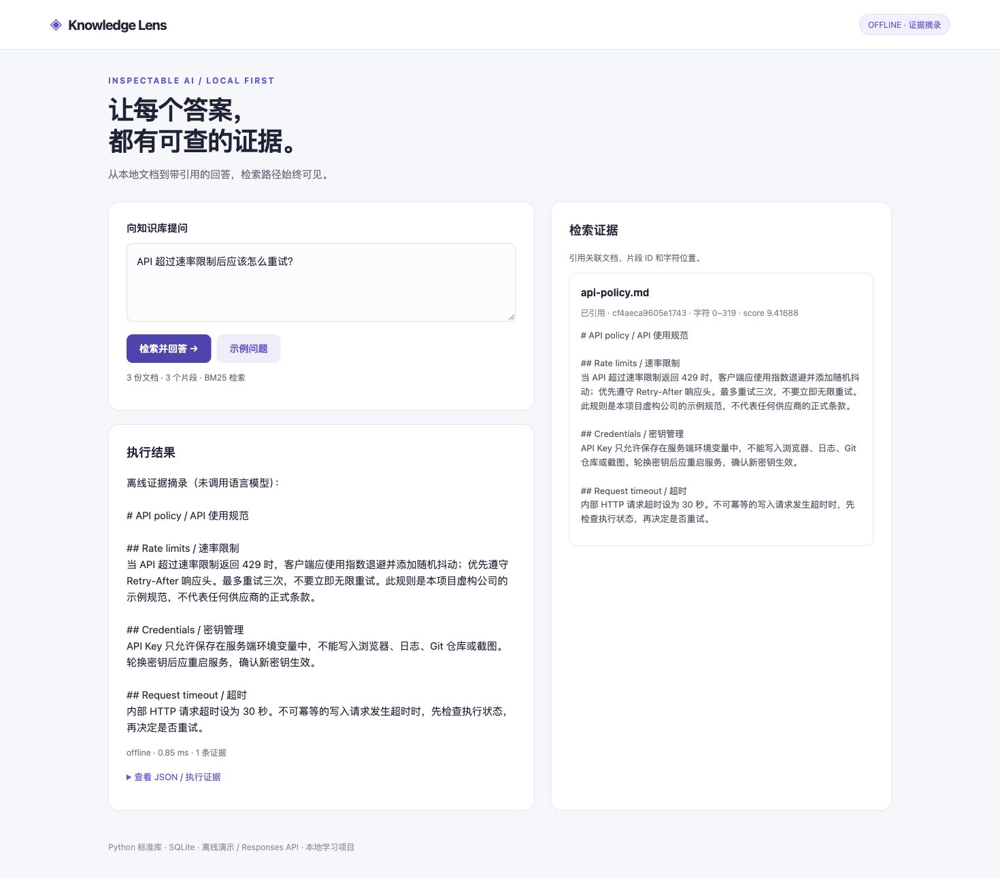
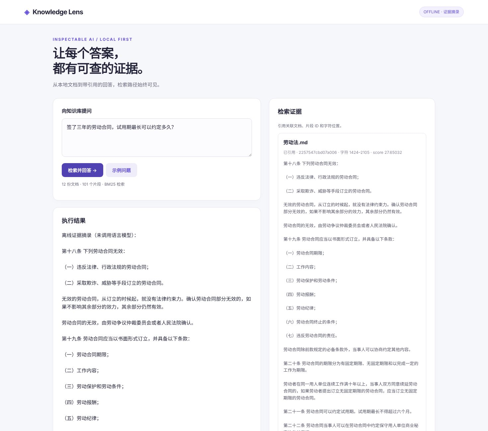

# Knowledge Lens

一个可以逐条检查证据的本地知识库问答项目。使用 BM25 进行中英文检索，可切换到 Responses API 生成带引用的回答。

[](https://github.com/william202201/knowledge-lens/actions/workflows/ci.yml)




这是使用 AI 辅助开发的学习与作品集项目。`examples/docs` 是虚构的演示资料；`examples/labor-law` 是 12 部公开劳动法规，用于真实语料评测。没有企业使用量、真实客户或生产效果的声明。

## 公开法规语料评测

用 12 部劳动法规（约 6.9 万字）和 50 道口语化测试题评测检索效果，对比切块方式与 Top-k：

| 配置 | 条文命中率 Top-3 | 条文命中率 Top-5 |
| --- | ---: | ---: |
| 固定长度 500 字（默认） | 69% | 84% |
| 按条文切块 500 字 | 78% | 82% |
| 固定长度 800 字 | 87% | 89% |
| **按条文切块 800 字** | **87%** | **91%** |

“条文命中率”要求检索到的片段完整包含标注的原文证据句，比“找对文件”更严格。剩下的错误主要是用词对不上（如问“购物卡代替工资”，原文是“以货币形式支付”），5 道无关题只有 1 道检索为空。完整对比、错误分析和取舍见 [docs/labor-law-evaluation.md](docs/labor-law-evaluation.md)。



## 快速开始

需要 Python 3.11+，运行时零第三方依赖。克隆后进入项目根目录，无需安装包：

```bash
git clone https://github.com/william202201/knowledge-lens.git
cd knowledge-lens
python -m knowledge_lens ingest examples/docs
python -m knowledge_lens serve
```

浏览器打开 http://127.0.0.1:8011 。默认离线模式，无需密钥，也不会产生模型调用费用。点击页面上的“检索并回答”即可演示。

## 实现了什么

- UTF-8 Markdown / TXT 导入，原子重建 SQLite 索引。
- 中英文分词、BM25 排序、相对分数过滤。
- 稳定片段 ID、源文件名与字符偏移，可回查证据。
- 严格回答结构与引用 ID 校验；证据不足时拒答。
- 两种切块方式：固定长度滑动窗口，或按标题/法条切块（`--strategy article`），保证一条法条不被切断。
- 两套评测：12 条合成回归案例；12 部公开劳动法规 + 50 道测试题，输出文档召回率、条文命中率、MRR 和无关问题拒答率。

离线模式返回真实检索片段，不进行语言生成。检索不到任何片段时直接拒答。在线模式发送问题和检索证据到 OpenAI，使用严格 JSON Schema，展示合法引用。引用 ID 校验能防止虚构引用，**不能证明每句话在语义上得到支持**。

## CLI 演示

```bash
python -m knowledge_lens ask "API 超过速率限制后应该怎么重试？"
python -m knowledge_lens evaluate

# 公开劳动法规知识库
python -m knowledge_lens --db labor.sqlite3 ingest examples/labor-law --strategy article --chunk-size 800
python -m knowledge_lens --db labor.sqlite3 ask "试用期最长可以约定多久？"
python -m knowledge_lens --db labor.sqlite3 evaluate --cases examples/labor-law-eval.jsonl --k 5
python -m knowledge_lens --db labor.sqlite3 serve   # 网页版

# 复现切块与 Top-k 对比表
python scripts/sweep_labor_law.py
```

可在子命令之前添加 `--db /path/to/demo.sqlite3`，切换 SQLite 文件。服务默认只监听本机地址。

## 接入真实模型

在**服务器终端**设置环境变量；`.env.example` 只提供字段示例，程序不会自动读取 `.env`。

```bash
export OPENAI_API_KEY="your-api-key"
export OPENAI_MODEL="a-model-you-have-access-to"
python -m knowledge_lens serve --live
```

模型需要支持 Responses API 和 Structured Outputs。选择你的账号实际有权限的模型；密钥不要提交到 Git。在线模式会将问题及检索片段发送到 OpenAI，并可能产生费用。请求关闭服务端响应存储 `store=false`，这不等于供应商整体零保留。HTTP 失败不自动重试，避免重复费用与误执行。

接口格式参考官方文档：[Responses API](https://developers.openai.com/api/docs/guides/migrate-to-responses)、[Function calling](https://developers.openai.com/api/docs/guides/function-calling)。当前交付验证包含离线运行与模拟接口契约，**没有使用真实 API Key 完成在线调用验证**。

## 验证与设计

```bash
python -m unittest discover -s tests -v
```

本地 Python 3.13 上 20 项测试通过，包含真实回环 HTTP 集成测试。GitHub Actions 配置为 Python 3.11 / 3.13；远端运行结果以 CI 为准。

- [架构与取舍](docs/architecture.md)
- [验证记录](docs/verification.md)
- [演示步骤与设计取舍](docs/walkthrough.md)

## 边界与后续工作

当前每次查询在内存重算 BM25，适合小型本地文档集；未实现 embedding、向量数据库、重排器、PDF/OCR、检索缓存或多租户。BM25 的相对分数阈值是启发式过滤，不能作为置信度或充分证据判定。中文双字分词不等于专业中文分词。

内置 HTTP 服务用于本地开发，缺少登录、限流与正式的部署网关，不能直接作为公网服务。提示中区分数据和指令只能降低风险，不能彻底解决提示注入。页面以纯文本渲染模型/文档内容；服务检查 Host、Origin 与 JSON 请求大小。

下一步建议：增加独立留出检索集，比较 BM25 与语义检索，再引入重排和逐句引用支持评测。

## License

MIT。欢迎提交可复现的问题或改进。
