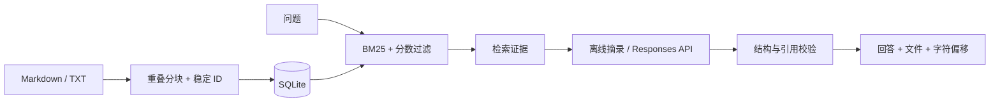

# 架构与取舍

## 检索

英文按字母数字词项分词，中文按连续汉字生成双字词项。分块默认 500 字符、80 字符重叠，保存原文字符范围 `[start,end)`；修改正文会改变稳定 ID，重新导入同样正文则保持不变。ID 由来源、起始位置和正文的 SHA-256 截断生成，不用于安全认证。

BM25 使用 k1=1.5、b=0.75，按片段统计词频和文档频率。查询词去重，避免重复输入放大分数。只保留正分数结果，再过滤低于最高分 15% 的片段，最多返回 3 条；这是一项明确可检查的启发式，未通过真实语料校准。相同分数按文件名和字符位置排序。

索引导入先读取全部资料，再在同一事务内重建。读取失败保留旧索引；成功导入移除旧内容。只接受 UTF-8 `.md` / `.txt`，单文件不超过 1 MB，不读取符号链接文件。当前无总语料上限，导入目录应由操作者控制。

## 生成与证据

在线生成使用严格 JSON Schema：`answer`、`answerable`、`citation_ids`。应用再次校验类型、引用集合，以及可回答结果至少包含一个引用；错误时返回失败，不显示未经检查的答案。证据为空时不调用模型。证据非空不代表足够，在线模型可拒答。

离线模式只是原文摘录，因此不评价生成质量。引用存在性校验不能检查蕴含、误读、遗漏或提示注入；生产版本需要逐句支持判定、冲突检测和人工评测。

## 工程边界

标准库和 SQLite 让演示可复制，也让关键逻辑容易阅读。每次查询读取并重算语料统计，复杂度大致随语料片段及词项数量增长；大型语料应使用持久倒排索引或检索服务。在线模式每次请求超时 45 秒、最多输出 2000 tokens。没有固定延迟或成本承诺。

HTTP 默认回环绑定，拒绝不符 Host 和跨源 Origin，不提供 CORS，并限定 JSON 请求体 16 KB。此措施适合本地演示，不能替代身份验证、租户隔离或生产 HTTP 网关。
